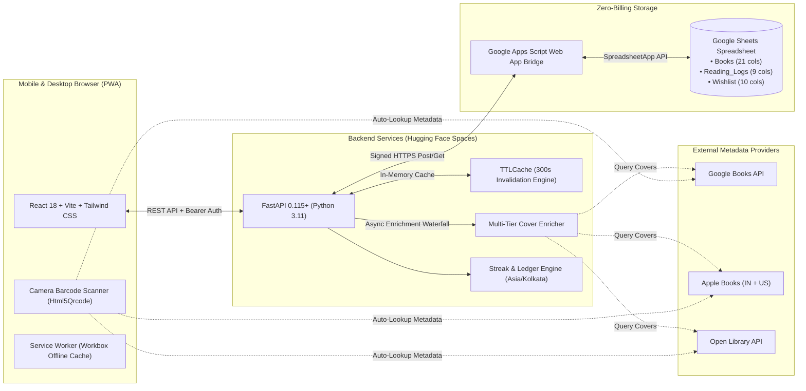

# Molat (মলাট) — Personal Library & Reading Streak PWA

[](https://molat-akdey.vercel.app)
[](https://huggingface.co/spaces/a-k-dey/Molat)
[](https://fastapi.tiangolo.com)
[](https://react.dev)
[](https://www.typescriptlang.org)
[](https://developer.mozilla.org/en-US/docs/Web/Progressive_web_apps)
[](https://www.google.com/sheets/about/)
[](#zero-billing-architecture)

> **Molat (মলাট)** is a Bengali literary term meaning **the protective outer jacket or cover of a book**.
>
> Molat is an artisanal, mobile-first Progressive Web App (PWA) designed for physical book collectors and avid readers. It offers complete physical library cataloguing, interactive visual bookshelf browsing, reading streak tracking, and acquisition wishlist management — operating on a strict **zero-billing infrastructure** using **Google Sheets as the database**.

---

## 🌟 Highlights

- **Zero Cloud Costs**: Entirely powered by free-tier infrastructure (Google Sheets + Hugging Face Spaces + Vercel). No credit card required.
- **Mobile-First PWA**: Installable to iOS Home Screen & Android with offline-first asset caching, touch gestures, and haptic feedback.
- **Instant Camera ISBN Scanner**: Point your smartphone camera at any book's barcode; Molat scans the ISBN and queries Open Library, Google Books, and Apple Books for instant metadata auto-fill.
- **3 Visual Browsing Modes**:
  - **Cover Grid**: High-resolution dust jackets with subtle spine depth and interactive volume drawers.
  - **Spine View**: Virtual physical bookshelf rendering spine widths, heights, and bindings scaled to actual page counts.
  - **Financial Ledger**: Financial portfolio table calculating total purchase cost (`CP`), retail market value (`MRP`), net savings, and discount percentages.
- **Duolingo-Style Reading Streak Engine**: Timezone-aware streak tracking (`Asia/Kolkata`) with daily page goals, 14-day grace freeze bridging, streak-at-risk alerts, and a 365-day GitHub-style interactive heatmap.
- **Acquisitions Wishlist**: Plan book acquisitions, compare budget target prices against retail MRP, and acquire volumes directly into your collection with 1 tap.
- **Multi-Tier Cover Enrichment**: 7-tier waterfall resolution with strict 1x1 tracking pixel and blank placeholder guards.
- **Anti-Vibe Editorial Craftsmanship**: Oxford Navy (`#1E3A8A`), warm ivory backgrounds, and typography engineered for biblio-enthusiasts across light and dark modes.

---

## 🏗️ Architecture



---

## 📊 Live Google Sheets Database Contract

Molat connects to a single Google Spreadsheet containing three dedicated tabs:

### 1. `Books` Tab (21 Columns)
The catalog of all physical volumes owned in your personal library.

| Col | Header | Type | Description |
|:---:|:---|:---:|:---|
| **A** | `book_id` | string | Unique primary key (`BOOK-001`, `BOOK-002`, ...) |
| **B** | `title` | string | Main title of the volume |
| **C** | `subtitle` | string | Subtitle or volume name (optional) |
| **D** | `authors` | string | Primary and contributing authors |
| **E** | `isbn_10` | string | 10-digit ISBN (stored as text with leading zeros) |
| **F** | `isbn_13` | string | 13-digit standard EAN barcode |
| **G** | `publisher` | string | Publisher imprint or press |
| **H** | `publication_year`| int | Year of publication |
| **I** | `language` | string | Language (e.g., `English`, `Bengali`) |
| **J** | `genre` | string | Primary genre classification |
| **K** | `cover_url` | string | Direct URL to front dust jacket image |
| **L** | `reading_status` | enum | `UNREAD` \| `READING` \| `COMPLETED` \| `PAUSED` \| `ABANDONED` |
| **M** | `condition` | enum | `New` \| `Good` \| `Fair` \| `Damaged` |
| **N** | `location` | string | Physical shelf placement (e.g., `Home Shelf`, `Living Room`) |
| **O** | `purchase_price`| float | Actual cost paid in INR (`CP`) |
| **P** | `rp` | float | Retail printed MRP in INR (`RP`) |
| **Q** | `purchase_date` | string | Date acquired (`YYYY-MM-DD`) |
| **R** | `rating` | int | Reader score from `1` to `5` |
| **S** | `notes` | string | Personal notes, acquisition stories, or edition details |
| **T** | `created_at` | string | Creation timestamp |
| **U** | `updated_at` | string | Last modification timestamp |

### 2. `Reading_Logs` Tab (9 Columns)
An append-only log recording every reading session to power the streak engine:
`log_id` · `book_id` · `session_date` · `start_page` · `end_page` · `pages_read` · `duration_minutes` · `session_note` · `created_at`

### 3. `Wishlist` Tab (10 Columns)
Future acquisitions and budget planning:
`wishlist_id` · `title` · `authors` · `isbn_13` · `genre` · `expected_rp` · `target_price` · `priority` · `notes` · `created_at`

---

## 🚀 Getting Started

### Prerequisites
- **Python 3.11+** with `uv` or `pip`
- **Node.js 18+** with `npm`
- A Google account (for Google Sheets & Apps Script)

---

### 1. Google Sheets & Apps Script Setup

1. Create a new Google Spreadsheet in Google Drive (e.g. named `Molat Library`).
2. Rename the first sheet tab to `Books`.
3. Open **Extensions** $\to$ **Apps Script**.
4. Paste the contents of [`apps-script/Code.gs`](apps-script/Code.gs) into the editor.
5. *(Optional)* Go to **Project Settings** $\to$ **Script Properties** and add `BRIDGE_TOKEN` with a secret passphrase.
6. Click **Deploy** $\to$ **New Deployment** $\to$ Select type: **Web App**:
   - **Execute as**: *Me*
   - **Who has access**: *Anyone*
7. Copy the generated Web App URL (`https://script.google.com/macros/s/.../exec`).

---

### 2. Backend Setup (FastAPI)

```bash
# Clone the repository
git clone https://github.com/akdey/Molat.git
cd Molat/backend

# Create virtual environment and install dependencies
uv venv
source .venv/bin/activate
uv pip install -e .

# Configure environment variables
cp .env.example .env  # edit with your values
```

#### `.env` Configuration:
```env
GOOGLE_SHEETS_BRIDGE_URL=https://script.google.com/macros/s/YOUR_BRIDGE_ID/exec
BRIDGE_TOKEN=your-optional-bridge-token
LIBRARY_KEY=your-admin-passkey-here
PORT=7860
CACHE_TTL_SECONDS=300
CORS_ORIGINS=["http://localhost:5173","https://molat-akdey.vercel.app"]
```

#### Run Backend Server:
```bash
uvicorn app.main:app --host 0.0.0.0 --port 7860 --reload
```
API Documentation will be available at `http://localhost:7860/docs`.

#### Run Backend Test Suite:
```bash
pytest -v
# 28 passed in 0.28s
```

---

### 3. Frontend Setup (React PWA)

```bash
cd ../frontend

# Install dependencies
npm install

# Start local Vite development server
npm run dev
```

Visit `http://localhost:5173` in your browser.

#### Build for Production:
```bash
npm run build
```

---

## 📱 Progressive Web App (PWA) Installation

Molat is packaged with a custom web manifest and Workbox service worker:
- **On iOS (Safari)**: Tap the Share button $\to$ tap **Add to Home Screen**.
- **On Android (Chrome)**: Tap the three-dot menu $\to$ tap **Install Molat**.
- **On Desktop (Chrome/Edge)**: Click the Install icon in the browser address bar.

---

## 🔒 Security & Reliability

- **Sanitized Formula Injections**: All cell writes are checked to prevent formula injection attacks (leading `=`, `+`, `-`, `@` characters are neutralized).
- **Passkey Protection**: Public visitors can read your catalog and portfolio stats; write and mutation endpoints (`POST /books`, `PATCH /books`, `POST /reading/logs`, `POST /wishlist`) are locked behind `X-Library-Key` authentication.
- **Cache Invalidation**: Changes to books or logs instantly bust the in-memory cache, keeping the app fast while ensuring Google Sheets is updated in real time.
- **Zero Tracking**: Zero analytics trackers, third-party advertising scripts, or invasive cookies.

---

## 🛠️ Tech Stack

| Layer | Technologies |
|---|---|
| **Frontend** | React 18, Vite 5, TypeScript 5.5, Tailwind CSS 3, Zustand, Lucide Icons |
| **PWA & Camera** | `vite-plugin-pwa`, Workbox, `html5-qrcode` (rear environment camera) |
| **Backend API** | FastAPI, Pydantic v2, Python 3.11, `httpx`, `cachetools`, `anyio` |
| **Database** | Google Sheets via Google Apps Script (Serverless JSON Web App) |
| **Hosting** | Vercel (Frontend SPA/PWA), Hugging Face Spaces (Docker runtime) |
| **Testing** | Pytest, Pytest-Asyncio, HTTPX TestClient |

---

## 📄 License

Distributed under the [MIT License](LICENSE). Built with craftsmanship for bibliophiles everywhere.
