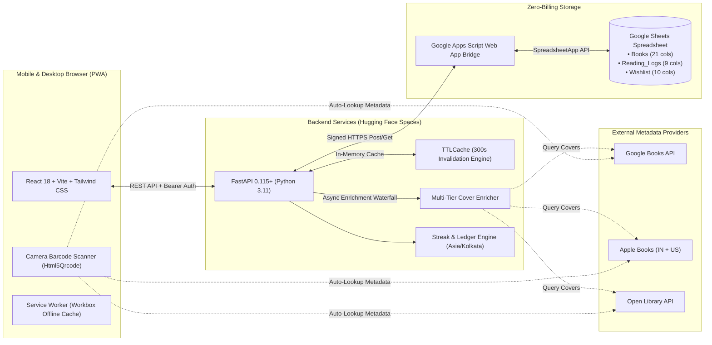

# Molat (মলাট) — Personal Library & Reading Streak PWA

[](https://molat-akdey.vercel.app)
[](https://huggingface.co/spaces/a-k-dey/Molat)
[](https://fastapi.tiangolo.com)
[](https://react.dev)
[](https://www.typescriptlang.org)
[](https://developer.mozilla.org/en-US/docs/Web/Progressive_web_apps)
[](https://www.google.com/sheets/about/)
[](#-zero-billing-philosophy)

> **Engineered by [AMIT KUMAR DEY](https://portfolio.akdey.vercel.app/)**

---

## 📖 About Molat

**Molat (মলাট)** is a Bengali literary word meaning **the protective outer jacket or cover of a book**.

Most book tracking tools today are either bloated social networks, proprietary walled gardens with paid subscriptions, or clunky spreadsheet setups. Molat was created for readers and physical book collectors who want:

1. **A beautiful, tactile digital twin of their physical bookshelf** that feels like browsing a private library.
2. **Habit-forming reading accountability** inspired by Duolingo-style streaks and GitHub-style contribution heatmaps.
3. **Total ownership of their data** with **zero ongoing cloud costs**, using **Google Sheets as the database**.

Whether cataloguing a multi-hundred volume collection, scanning new arrivals at a bookshop with your phone's camera, or celebrating a 30-day continuous reading streak, Molat gives you a private, lightning-fast, and distraction-free home for your library.

---

## ✨ Features

### 📱 Progressive Web App (PWA) with Offline Capabilities
- **Installable Native App Experience**: Install Molat directly to your iOS or Android home screen or desktop with a single tap.
- **Offline Caching**: Built with Workbox service workers to precache core assets and jacket images (`CacheFirst` for book jackets, `StaleWhileRevalidate` for library APIs).
- **Mobile Ergonomics**: Thumb-zone bottom navigation bar, haptic vibration feedback, pull-to-refresh, and smooth gesture transitions.

### 📷 Instant Camera ISBN Barcode Scanner
- **Live Optical Barcode Detection**: Point your device's camera at any standard book barcode (EAN-13 / ISBN-13 / UPC-A).
- **Multi-Source Metadata Auto-Fill**: Automatically queries Open Library, Google Books, and Apple Books to populate title, subtitle, author(s), genre, and high-resolution cover artwork.
- **Laser Viewfinder**: Real-time camera viewfinder targeting the rear environment autofocus lens with haptic feedback when a barcode is locked.

### 📚 Three Visual Shelf Browsing Modes
- **Cover Grid**: High-resolution dust jackets with subtle 3D spine depth, tactile tilt angles, and quick-access volume inspection drawers.
- **Physical Spine View**: An interactive virtual bookshelf rendering proportional book heights, spine widths, and embossed titles scaled dynamically according to page counts.
- **Financial Portfolio Ledger**: A detailed financial table calculating your total investment (`Cost Price`), retail market value (`MRP`), net savings in INR (₹), and volume discount percentages with multi-column sorting.

### 🔥 Duolingo-Style Reading Streak Tracker
- **Timezone-Aware Calculations**: Daily streak engine running in `Asia/Kolkata` time.
- **Active Reading Progress Card**: Displays current reading session progress, daily goal completion, and automated reading velocity (pages/day).
- **Grace Freeze Bridging**: Qualified reading bridging that prevents an accidental streak loss if a user read heavily earlier in the week (up to 1 freeze every 14 days).
- **Streak-At-Risk Alerts**: Visual ambient warnings when today's reading goal hasn't been logged yet.
- **365-Day Contribution Heatmap**: Interactive GitHub-style reading heatmap mapping page count intensity across every day of the calendar year.

### 🎯 Acquisitions Wishlist
- **Budget & Purchase Planning**: Track books you want to purchase, setting budget target prices alongside retail MRP.
- **1-Click Shelf Acquisition**: When you purchase a book from your wishlist, a single click moves it into your active library (`Books` tab), records the actual purchase price and condition, and archives the wishlist item.

### 🖼️ Multi-Tier Automated Cover Enrichment
- **7-Tier Fallback Waterfall**:
  1. Google Books (ISBN-13 / ISBN-10)
  2. Google Books (Title + Author)
  3. Apple Books India (`country=IN`, high-res 600x600 artwork)
  4. Apple Books Global (`country=US` fallback)
  5. Open Library (ISBN `cover_i`)
  6. Open Library (Title + Author)
  7. Direct Open Library Jacket Endpoint
- **Quality Guard**: Automatically detects and rejects 1x1 transparent tracking pixels, blank placeholders, or broken URLs.

### 🎨 Anti-Vibe Editorial Design
- **Literary Palette**: Oxford Navy (`#1E3A8A`), warm ivory surfaces (`#FBF9F5`), muted borders, and quiet typography avoiding generic AI aesthetics.
- **Dark Mode Support**: Seamless toggle between warm paper daylight and low-contrast midnight obsidian themes.

### 🔒 Privacy & Passkey Protection
- **Passkey-Guarded Admin Actions**: Public visitors can browse your library and stats in read-only mode; book creation, edits, log submissions, and wishlist mutations require your secret `X-Library-Key`.
- **Sanitized Formula Injections**: All cell writes neutralize formula injection attacks (leading `=`, `+`, `-`, `@`).
- **Zero Telemetry**: No third-party trackers, analytics, or cookies.

---

## 🏗️ Architecture



---

## 📊 Live Google Sheets Database Contract

Molat connects to a single Google Spreadsheet containing three dedicated tabs:

### 1. `Books` Tab (21 Columns)
The catalog of all physical volumes owned in your personal library.

| Col | Header | Type | Description |
|:---:|:---|:---:|:---|
| **A** | `book_id` | string | Unique primary key (`BOOK-001`, `BOOK-002`, ...) |
| **B** | `title` | string | Main title of the volume |
| **C** | `subtitle` | string | Subtitle or volume name (optional) |
| **D** | `authors` | string | Primary and contributing authors |
| **E** | `isbn_10` | string | 10-digit ISBN (stored as text with leading zeros) |
| **F** | `isbn_13` | string | 13-digit standard EAN barcode |
| **G** | `publisher` | string | Publisher imprint or press |
| **H** | `publication_year`| int | Year of publication |
| **I** | `language` | string | Language (e.g., `English`, `Bengali`) |
| **J** | `genre` | string | Primary genre classification |
| **K** | `cover_url` | string | Direct URL to front dust jacket image |
| **L** | `reading_status` | enum | `UNREAD` \| `READING` \| `COMPLETED` \| `PAUSED` \| `ABANDONED` |
| **M** | `condition` | enum | `New` \| `Good` \| `Fair` \| `Damaged` |
| **N** | `location` | string | Physical shelf placement (e.g., `Home Shelf`, `Living Room`) |
| **O** | `purchase_price`| float | Actual cost paid in INR (`CP`) |
| **P** | `rp` | float | Retail printed MRP in INR (`RP`) |
| **Q** | `purchase_date` | string | Date acquired (`YYYY-MM-DD`) |
| **R** | `rating` | int | Reader score from `1` to `5` |
| **S** | `notes` | string | Personal notes, acquisition stories, or edition details |
| **T** | `created_at` | string | Creation timestamp |
| **U** | `updated_at` | string | Last modification timestamp |

### 2. `Reading_Logs` Tab (9 Columns)
An append-only log recording every reading session to power the streak engine:
`log_id` · `book_id` · `session_date` · `start_page` · `end_page` · `pages_read` · `duration_minutes` · `session_note` · `created_at`

### 3. `Wishlist` Tab (10 Columns)
Future acquisitions and budget planning:
`wishlist_id` · `title` · `authors` · `isbn_13` · `genre` · `expected_rp` · `target_price` · `priority` · `notes` · `created_at`

---

## 🚀 Getting Started

### Prerequisites
- **Python 3.11+** with `uv` or `pip`
- **Node.js 18+** with `npm`
- A Google account (for Google Sheets & Apps Script)

---

### 1. Google Sheets & Apps Script Setup

1. Create a new Google Spreadsheet in Google Drive (e.g. named `Molat Library`).
2. Rename the first sheet tab to `Books`.
3. Open **Extensions** $\to$ **Apps Script**.
4. Paste the contents of [`apps-script/Code.gs`](apps-script/Code.gs) into the editor.
5. *(Optional)* Go to **Project Settings** $\to$ **Script Properties** and add `BRIDGE_TOKEN` with a secret passphrase.
6. Click **Deploy** $\to$ **New Deployment** $\to$ Select type: **Web App**:
   - **Execute as**: *Me*
   - **Who has access**: *Anyone*
7. Copy the generated Web App URL (`https://script.google.com/macros/s/.../exec`).

---

### 2. Backend Setup (FastAPI)

```bash
# Clone the repository
git clone https://github.com/akdey/Molat.git
cd Molat/backend

# Create virtual environment and install dependencies
uv venv
source .venv/bin/activate
uv pip install -e .

# Configure environment variables
cp .env.example .env  # edit with your values
```

#### `.env` Configuration:
```env
GOOGLE_SHEETS_BRIDGE_URL=https://script.google.com/macros/s/YOUR_BRIDGE_ID/exec
BRIDGE_TOKEN=your-optional-bridge-token
LIBRARY_KEY=your-admin-passkey-here
PORT=7860
CACHE_TTL_SECONDS=300
CORS_ORIGINS=["http://localhost:5173","https://molat-akdey.vercel.app"]
```

#### Run Backend Server:
```bash
uvicorn app.main:app --host 0.0.0.0 --port 7860 --reload
```
API Documentation will be available at `http://localhost:7860/docs`.

#### Run Backend Test Suite:
```bash
pytest -v
# 28 passed in 0.28s
```

---

### 3. Frontend Setup (React PWA)

```bash
cd ../frontend

# Install dependencies
npm install

# Start local Vite development server
npm run dev
```

Visit `http://localhost:5173` in your browser.

#### Build for Production:
```bash
npm run build
```

---

## 📱 Progressive Web App (PWA) Installation

Molat is packaged with a custom web manifest and Workbox service worker:
- **On iOS (Safari)**: Tap the Share button $\to$ tap **Add to Home Screen**.
- **On Android (Chrome)**: Tap the three-dot menu $\to$ tap **Install Molat**.
- **On Desktop (Chrome/Edge)**: Click the Install icon in the browser address bar.

---

## 🛠️ Tech Stack

| Layer | Technologies |
|---|---|
| **Frontend** | React 18, Vite 5, TypeScript 5.5, Tailwind CSS 3, Zustand, Lucide Icons |
| **PWA & Camera** | `vite-plugin-pwa`, Workbox, `html5-qrcode` (rear environment camera) |
| **Backend API** | FastAPI, Pydantic v2, Python 3.11, `httpx`, `cachetools`, `anyio` |
| **Database** | Google Sheets via Google Apps Script (Serverless JSON Web App) |
| **Hosting** | Vercel (Frontend SPA/PWA), Hugging Face Spaces (Docker runtime) |
| **Testing** | Pytest, Pytest-Asyncio, HTTPX TestClient |

---

## 👨‍💻 Author & Engineering

Designed & engineered with precision by **[AMIT KUMAR DEY](https://portfolio.akdey.vercel.app/)**.

---

## 📄 License

Distributed under the [MIT License](LICENSE). Built with craftsmanship for bibliophiles everywhere.
